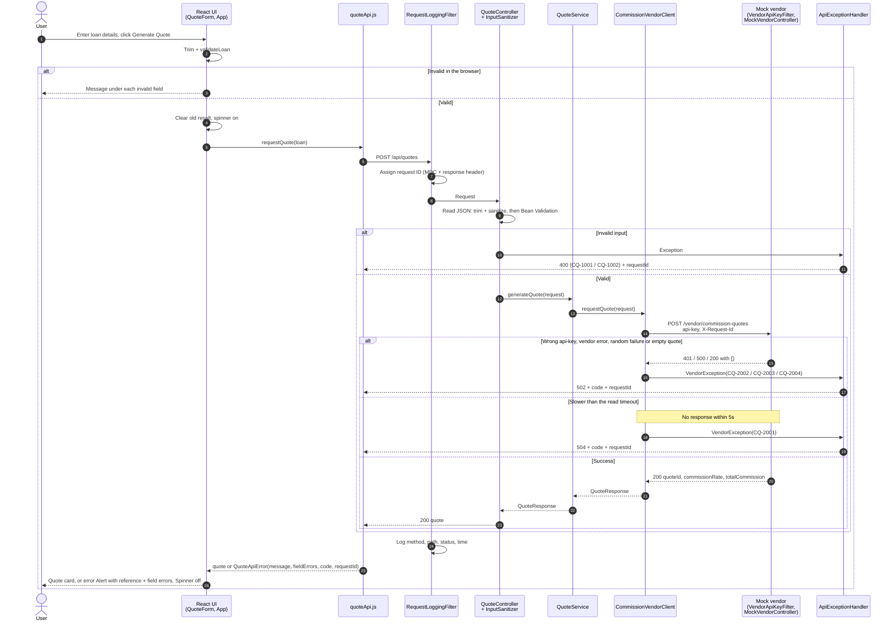

# Commission Quote App

A web app for staff to enter loan details and get a commission quote from a third-party vendor API. The vendor API isn't
available yet, so the backend also hosts a **mock vendor API** that implements the agreed contract.

**Tech stack:** Java 17, Spring Boot 4.1, Gradle 9 (wrapper) · React 19, MUI 9, Vite 8, Vitest 5 · Docker

## Prerequisites

Only Docker (Docker Desktop, or Docker Engine with Compose v2). Java, Node and Gradle aren't needed on your machine.

## Running the app

```bash
docker compose up --build
```

Open http://localhost:8080. Stop with `docker compose down`.

- The build runs all frontend and backend tests. If any test fails, no image is created.
- A single container: Spring Boot serves the API, the mock vendor and the React app on one port.
- Docker checks the app's health every 30 seconds (`/actuator/health`); `docker ps` shows `healthy`.

## Development mode (live reload)

Both modes use port 8080, so stop one before starting the other:

```bash
docker compose down
docker compose -f docker-compose.dev.yml up -d
```

Open **http://localhost:5173**. Frontend changes show immediately; backend changes restart the app in a few seconds.
The first start takes a few minutes while dependencies download.

```bash
docker compose -f docker-compose.dev.yml restart frontend   # after changing package.json
docker compose -f docker-compose.dev.yml restart backend    # after changing build.gradle / gradle.properties
docker compose -f docker-compose.dev.yml logs -f            # follow the logs
docker compose -f docker-compose.dev.yml down               # stop dev mode
```

The production container doesn't reload; changes show after a rebuild (hard refresh the browser if needed).

## Running tests

Tests run as part of `docker compose build` and run in parallel (JUnit and Vitest). A failure fails the build.
126 backend tests (unit + integration) and 71 frontend tests.

While dev mode is running:

```bash
docker compose -f docker-compose.dev.yml exec frontend npm test
docker compose -f docker-compose.dev.yml exec backend ./gradlew test
```

## Configuration

| File                                         | What's in it                                                                       |
| -------------------------------------------- | ---------------------------------------------------------------------------------- |
| `backend/src/main/resources/application.yml` | Vendor URL, API key, timeouts, commission rates, mock vendor behaviour, log format |
| `backend/gradle.properties`                  | Spring Boot plugin and Java versions                                               |
| `.env` (project root)                        | Docker image versions and ports                                                    |
| `frontend/.env`                              | Currency code                                                                      |
| `AppConstants.java`, `frontend/src/constants.js` | Fixed values: paths, loan limits, messages (limits must match in both)         |

Two environment variables matter for a deployment:

| Variable              | Meaning                                                                                                    |
| --------------------- | ---------------------------------------------------------------------------------------------------------- |
| `VENDOR_API_KEY`      | Required. The app refuses to start without it. The compose files set `local-dev-key` for local use.        |
| `MOCK_VENDOR_ENABLED` | Turns the mock vendor on. Off by default so a real deployment never exposes it; the compose files turn it on. |

```bash
VENDOR_API_KEY=some-secret docker compose up --build
```

## Business rules and validation

|                    |                                                                                     |
| ------------------ | ----------------------------------------------------------------------------------- |
| `loanAmount`       | 1,000 – 5,000,000, at most 2 decimal places                                         |
| `loanTermInMonths` | 1 – 360, whole months                                                               |
| `riskBand`         | `LOW`, `MEDIUM`, `HIGH`                                                             |
| Commission rate    | LOW 1.00%, MEDIUM 1.50%, HIGH 2.00%, +0.25% if the term is over 60 months           |
| Total commission   | `loanAmount × rate / 100`, rounded half-up to 2 decimal places                      |

Every field is checked in the browser (message under the field) and again on the server.

- **Trimming:** leading and trailing whitespace is removed from every value.
- **Sanitizing:** number fields may only contain digits and `.`; the risk band must be exactly one of the three values.
  Anything else is rejected with a generic 400 `"Request contains invalid characters"`, which never echoes or logs the
  input (`InputSanitizer`, applied to our API and the mock vendor).

## Test scenarios

| loanAmount             | Vendor behaviour                         | User sees                                                |
| ---------------------- | ---------------------------------------- | -------------------------------------------------------- |
| `1001`                 | Returns 500                              | 502: "The commission vendor could not generate a quote." |
| `1002`                 | Waits 10s (our timeout is 5s)            | 504: "The commission vendor timed out."                  |
| any other valid amount | Success, but fails randomly 20% of the time | Quote, or the 502 message                             |

The vendor rejects a missing or wrong `api-key` header with 401:

```bash
curl -i -X POST localhost:8080/vendor/commission-quotes -H 'Content-Type: application/json' \
  -d '{"loanAmount":10000,"loanTermInMonths":12,"riskBand":"LOW"}'
```

## API

`POST /api/quotes` with `{ "loanAmount": 100000, "loanTermInMonths": 72, "riskBand": "MEDIUM" }`

| Status | Meaning                                                                                       |
| ------ | --------------------------------------------------------------------------------------------- |
| 200    | `{ "quoteId": "…", "commissionRate": 1.75, "totalCommission": 1750.00 }` (rate is a percentage) |
| 400    | Invalid input                                                                                 |
| 502    | Vendor error, or an empty / invalid quote from the vendor                                     |
| 504    | Vendor timed out                                                                              |

Every error has the same shape, with an error ID (`code`) the frontend can react to and the `requestId` to find it in
the logs:

```json
{ "code": "CQ-2001", "message": "The commission vendor timed out. Please try again.", "fieldErrors": {}, "requestId": "3f2c…" }
```

| Code      | Meaning                                       | Code      | Meaning                                     |
| --------- | --------------------------------------------- | --------- | ------------------------------------------- |
| `CQ-1001` | Validation failed (see `fieldErrors`)         | `CQ-2001` | Vendor timed out (504)                      |
| `CQ-1002` | Invalid characters                            | `CQ-2002` | Vendor error (502)                          |
| `CQ-1003` | Unreadable request body                       | `CQ-2003` | Vendor returned an empty response (502)     |
| `CQ-1004` | Not found                                     | `CQ-2004` | Vendor rejected our API key (502)           |
| `CQ-1005` | Method not allowed                            | `CQ-3001` | Mock vendor: invalid API key (401)          |
| `CQ-1006` | Unsupported content type                      | `CQ-3002` | Mock vendor: simulated failure (500)        |
|           |                                               | `CQ-9001` | Unexpected error (500, details only logged) |

The UI shows the message with a reference line (`Reference: CQ-2001 · <requestId>`). For an empty response
(`CQ-2003`, or a 200 without a quote) it shows: "The commission API returned an empty response, so a quote could not be
generated for the given input." The codes are defined in `ErrorCode.java`.

## Project structure

```
backend/src/main/java/com/example/commissionquote/
├── common/        constants, error codes and handling, secure logging, input sanitizing, security headers
├── quote/         our API: controller -> service -> vendor client
└── vendor/        mock vendor: API key filter, controller, commission calculator

frontend/src/
├── api/           the only code that calls the backend
├── components/    QuoteForm, QuoteResult, ErrorBoundary (MUI)
├── validation/    form validation
├── utils/         number checks and formatting
└── constants.js   API path, limits, risk bands, messages
```

`quote` and `vendor` only talk over HTTP. To switch to the real vendor, point `vendor.*` in `application.yml` at it and
leave the mock off (the default), or delete the `vendor` package.

## Sequence diagram



## Logging

Console only, no log file (ready to forward to a log service such as New Relic later). One line per event:

```
2026-11-03T02:51:58.875Z WARN  [req=1eb2df35-…] [code=CQ-2001] c.e.c.common.error.ApiExceptionHandler - Commission vendor timed out
```

- `req` is the request ID: on every line for a request, returned in the `X-Request-Id` header and passed to the vendor.
- `code` is the error ID, the same one returned to the client.
- `SecureLogger` strips line breaks from logged values, and the log pattern does the same, so log lines can't be forged.
- Never logged: the API key, loan amounts, or rejected input.

## Design decisions

- **The API key stays on the server** and is checked in constant time, in a filter before the body is read.
- **Input is allow-listed and rejected, not cleaned**, so altered input is never processed.
- **Vendor failures map to 502 / 504** with plain messages; details are logged, not shown.
- **`BigDecimal` for money**, so there are no rounding errors.
- **No retries**: retrying could create duplicate vendor quotes without idempotency keys.
- **Config is validated at startup**, so a missing API key or rate stops the app immediately.
- **The mock vendor is off unless enabled**, so a real deployment can't expose it.
- **Security headers on every response** (Content-Security-Policy, X-Frame-Options, X-Content-Type-Options,
  Referrer-Policy).
- **One Docker image, Docker for everything**: simplest to run, and local tool versions don't matter.

## Future scope

- Retries with an idempotency key, and a circuit breaker for the vendor.
- Persist quotes with an audit trail.
- Authentication for staff users and rate limiting (our own API is currently open).
- Serve the loan limits from the backend so the frontend doesn't repeat them.
- Ship logs to a log service (e.g. New Relic) and add metrics.
- A CI pipeline that builds and tests on every push.

## AI usage

- Used Claude (Claude Code) to clarify the requirements (formula, limits, scenarios, structure) before writing code.
- Claude wrote the initial backend, frontend, Docker setup and tests. I reviewed and adjusted them.
- [`PROMPTS.md`](PROMPTS.md) holds the prompts that regenerate this app from scratch, in order, with the ground
  rules, structure and requirements used.
